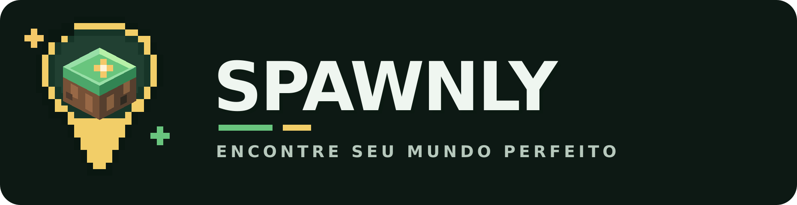
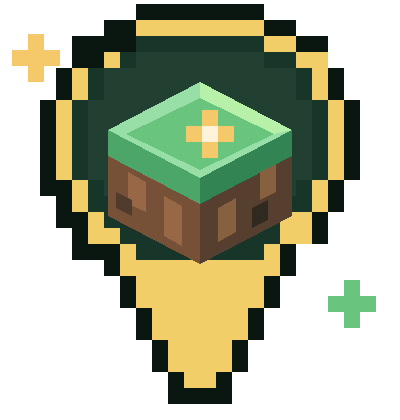

 

 

Site de sugestões de seeds para Minecraft com questionário de preferências, 
recomendações por compatibilidade e <b>mapa de biomas</b>, publicado na <b>Vercel</b>.

<h2>

</h2>

<table>
<tr>
<td align="center" width="25%"><a href="#sobre-o-mundo"><b>Sobre o Mundo</b></a></td>
<td align="center" width="25%"><a href="#novidades"><b>Novidades</b></a></td>
<td align="center" width="25%"><a href="#jornada-do-jogador"><b>Jornada do Jogador</b></a></td>
<td align="center" width="25%"><a href="#crafting-table-tecnologias"><b>Crafting Table</b></a></td>
</tr>
<tr>
<td align="center"><a href="#mapa-de-chunks-arquitetura"><b>Mapa de Chunks</b></a></td>
<td align="center"><a href="#inventario-banco-de-dados"><b>Inventário</b></a></td>
<td align="center"><a href="#comandos-rotas-da-api"><b>Comandos</b></a></td>
<td align="center"><a href="#iniciando-o-servidor"><b>Iniciando o Servidor</b></a></td>
</tr>
</table>

<h3>Paleta do mundo</h3>

<h2 id="sobre-o-mundo">

</h2>

<blockquote>
<b>Advancement Made!</b> Você encontrou o Spawnly.
</blockquote>

O <b>Spawnly</b> recomenda seeds de Minecraft que combinam com o seu estilo de jogo. O usuário responde um questionário sobre edição, bioma, modo de jogo e estruturas desejadas, e o sistema retorna seeds previamente cadastradas e verificadas, ordenadas por compatibilidade.

<table>
<tr>
<td width="50%">

<ul>
<li>Cadastra usuários, preferências e seeds</li>
<li>Consulta o catálogo e as recomendações</li>
<li>Edita dados, filtros e seeds</li>
<li>Exclui registros mediante confirmação</li>
</ul>

</td>
<td width="50%">

<ul>
<li>Não descobre seeds aleatórias do jogo</li>
<li>Não simula login falso</li>
<li>Não recomenda seeds sem edição e versão</li>
</ul>

</td>
</tr>
</table>

<h3>CRUD obrigatório</h3>

<table>
<tr>
<td width="15%" align="center"></td>
<td>Cadastrar usuários, preferências e seeds.</td>
</tr>
<tr>
<td align="center"></td>
<td>Consultar cadastros, catálogo e recomendações.</td>
</tr>
<tr>
<td align="center"></td>
<td>Editar dados de usuário, filtros e seeds.</td>
</tr>
<tr>
<td align="center"></td>
<td>Excluir registros mediante confirmação.</td>
</tr>
</table>

<blockquote>
<b>Limite de escopo:</b> o site recomenda apenas seeds já registradas no banco de dados. Isso mantém o trabalho realizável e as recomendações confiáveis.
</blockquote>

<h2 id="novidades">

</h2>

<blockquote>
<b>Advancement Made!</b> O Spawnly saiu do localhost e está no ar: <a href="https://spawnly-six.vercel.app"><b>spawnly-six.vercel.app</b></a>
</blockquote>

<table>
<tr>
<th align="center" width="14%">Recurso</th>
<th align="left">O que mudou</th>
</tr>
<tr>
<td align="center"></td>
<td><b>Site publicado na Vercel</b>: front-end estático e API serverless na mesma hospedagem.</td>
</tr>
<tr>
<td align="center"></td>
<td><b>Mapa de biomas</b> (<code>/mapa/mapa.html</code>): informe uma seed numérica, a versão do Java e as coordenadas X/Z. O servidor gera os biomas com a biblioteca <a href="https://github.com/xpple/cubiomes">Cubiomes</a> (C, MIT) e o navegador pinta tudo em <code>&lt;canvas&gt;</code>. Suporta Java 1.20.6, 1.21.1, 1.21.4 e 1.21.11, e a URL guarda os parâmetros para compartilhar o mapa.</td>
</tr>
<tr>
<td align="center"></td>
<td><b>PostgreSQL relacional</b> no Render, com tabelas, chaves estrangeiras, transações e importação segura do catálogo. Uma API autenticada no Render conversa com a Vercel.</td>
</tr>
<tr>
<td align="center"></td>
<td>Chamadas Vercel para Render autenticadas por <b>OIDC nativo da Vercel</b> (sem chaves persistentes), <b>token por usuário</b> nas rotas do jogador e <b>chave administrativa</b> para cadastrar, editar e excluir seeds.</td>
</tr>
<tr>
<td align="center"></td>
<td><b>Catálogo real importado</b>: 90 seeds com biomas, estruturas e faixas de versão. O questionário apresenta <b>64 opções de biomas</b> (54 do Overworld, 5 do Nether e 5 do End), agrupadas pela API em 17 categorias de recomendação.</td>
</tr>
<tr>
<td align="center"></td>
<td><b>Sessão de usuário</b> no navegador, páginas de <b>Recomendações</b> e <b>Gerenciar seeds</b> restauradas e integradas à API, e nova navegação: Início, Questionário, Recomendações, Gerenciar seeds e Mapa.</td>
</tr>
<tr>
<td align="center"></td>
<td>Nova <b>logo</b> (<code>assets/logo.png</code> e <code>assets/icon.png</code>) e fonte pixelada <i>Press Start 2P</i> no site.</td>
</tr>
</table>

<h3>Como o site no ar funciona</h3>

<pre>
 Navegador ──► Vercel (site estático + /api/*) ──OIDC──► Render (API) ──► PostgreSQL
                    │
                    └──► /api/mapa ──► gerar_mapa (C + Cubiomes) ──► biomas em Canvas
</pre>

<blockquote>
<b>Observação:</b> o servidor Render usa plano gratuito e pode demorar para acordar na primeira requisição. O mapa só suporta <b>Minecraft Java</b>. Para verificar a conexão com o banco em produção, consulte <a href="https://spawnly-six.vercel.app/api/status"><code>/api/status</code></a>.
</blockquote>

<h2 id="jornada-do-jogador">

</h2>

<table>
<tr>
<th align="center">Nível</th>
<th align="left">Etapa</th>
<th align="left">Descrição</th>
</tr>
<tr>
<td align="center"></td>
<td><b>Entrar ou cadastrar</b></td>
<td>Informar nome de jogador, edição e versão. O cadastro gera um token de sessão no navegador; não há login tradicional por senha.</td>
</tr>
<tr>
<td align="center"></td>
<td><b>Responder ao questionário</b></td>
<td>Escolher Java ou Bedrock, bioma, modo de jogo e estruturas desejadas.</td>
</tr>
<tr>
<td align="center"></td>
<td><b>Ver recomendações</b></td>
<td>Receber cards com código da seed, versão, características e pontuação de compatibilidade.</td>
</tr>
<tr>
<td align="center"></td>
<td><b>Refinar preferências</b></td>
<td>Alterar filtros sem repetir todo o processo.</td>
</tr>
<tr>
<td align="center"></td>
<td><b>Explorar o mapa</b></td>
<td>Colar o código de uma seed e ver os biomas ao redor do spawn antes de abrir o jogo.</td>
</tr>
</table>

<pre>
Hotbar:  [ 1 Entrar ][ 2 Questionário ][ 3 Recomendações ][ 4 Refinar ][ 5 Mapa ]
</pre>

<b>Slots de bioma (exemplos para o questionário)</b>

<table>
<tr>
<th>1</th><th>2</th><th>3</th><th>4</th><th>5</th><th>6</th><th>7</th><th>8</th><th>9</th>
</tr>
<tr>
<td align="center">Planície</td><td align="center">Deserto</td><td align="center">Neve</td><td align="center">Montanha</td><td align="center">Floresta</td><td align="center">Oceano</td><td align="center">Pântano</td><td align="center">Picos</td><td align="center">Savana</td>
</tr>
</table>

O questionário completo apresenta 54 biomas do Overworld, 5 do Nether e 5 do End. A API normaliza as escolhas em 17 categorias; biomas sem correspondência específica entram em <code>raros</code>. Esta lista é só um exemplo.

<h2 id="crafting-table-tecnologias">

</h2>

<table>
<tr>
<td align="center" width="25%">  HTML5 CSS3 responsivo JavaScript e Canvas</td>
<td align="center" width="25%">  Node.js Funções serverless (Vercel) API no Render</td>
<td align="center" width="25%">  PostgreSQL (produção) MariaDB (local) Script SQL/DDL</td>
<td align="center" width="25%">  C + Cubiomes GCC no build Canvas 2D</td>
</tr>
</table>

<pre>
   RECEITA DE CRAFTING

  ┌───────┬───────┬───────┐
  │ HTML5 │ CSS3  │  JS   │
  ├───────┼───────┼───────┤       ┌─────────────┐
  │ Node  │Vercel │Postgre│ ───►  │  SPAWNLY x1 │
  ├───────┼───────┼───────┤       └─────────────┘
  │Render │Cubiome│ OIDC  │
  │       │   C   │       │
  └───────┴───────┴───────┘
</pre>

<h2 id="mapa-de-chunks-arquitetura">

</h2>

<pre>
 ┌──────────────────┐      ┌──────────────────┐      ┌──────────────────┐
 │    FRONT-END     │      │  API (Vercel)    │      │   API (Render)   │
 │                  │ ───► │                  │ ───► │                  │
 │ HTML5 + CSS3 + JS│ ◄─── │ Funções serverless│ ◄─── │  Node.js + OIDC  │
 └──────────────────┘      └──────────────────┘      └──────────────────┘
      Navegador                /api/* e /api/mapa             │
                                    │                         ▼
                                    ▼                  ┌─────────────┐
                            ┌────────────────┐         │ PostgreSQL  │
                            │ gerar_mapa (C) │         └─────────────┘
                            │   Cubiomes     │
                            └────────────────┘
</pre>

O backend Express com MariaDB continua na pasta <code>backend/</code> e serve para rodar tudo localmente (veja <a href="#iniciando-o-servidor">Iniciando o Servidor</a>).

<b>Estrutura de pastas implementada</b>

<pre>
Spawnly/
├── README.md
├── render.yaml              # API SQL no Render
├── assets/                  # logo.png, icon.png, banner, divisores
├── database/                # SQL do MariaDB (uso local)
├── backend/                 # Express + MariaDB (uso local)
│   ├── routes/ services/ scripts/ test/
│   └── server.js
├── render-bridge/           # API autenticada: Node + PostgreSQL
└── frontend/                # site publicado na Vercel
    ├── index.html  questionario.html  resultados.html  gerenciar.html
    ├── mapa/mapa.html
    ├── api/                 # funções serverless (CRUD, recomendação, mapa)
    ├── native/              # gerar_mapa.c + build.sh (Cubiomes)
    ├── biomas/              # ícones dos biomas
    ├── css/  js/
    └── vercel.json
</pre>

Na Vercel, o diretório <code>frontend/</code> é publicado como site estático e <code>frontend/api/</code> vira as funções serverless.

<h2 id="inventario-banco-de-dados">

</h2>

<table>
<tr>
<th align="left">Tabela</th>
<th align="left">Campos</th>
<th align="left">Função</th>
</tr>
<tr>
<td><code>usuarios</code></td>
<td><code>id</code>, <code>nome</code>, <code>edicao</code>, <code>versao</code></td>
<td>Cadastro e manutenção de usuários</td>
</tr>
<tr>
<td><code>preferencias_usuarios</code></td>
<td><code>id</code>, <code>usuario_id</code>, <code>dimensao</code>, <code>valor</code>, <code>peso</code></td>
<td>Preferências normalizadas e editáveis do questionário</td>
</tr>
<tr>
<td><code>seeds</code></td>
<td><code>id</code>, <code>codigo</code>, <code>edicao_versao_id</code>, <code>nome</code>, <code>spawn_texto</code>, <code>nota</code></td>
<td>Catálogo de mundos recomendáveis</td>
</tr>
</table>

<pre>
 ┌──────────────┐ 1      N ┌────────────────┐
 │   usuarios   │──────────│ preferencias_  │
 │              │          │    usuarios    │
 └──────────────┘          └────────────────┘

 ┌──────────────┐
 │    seeds     │   (catálogo independente, consultado pelas regras
 └──────────────┘    de recomendação)
</pre>

O modelo acima representa o ambiente local MariaDB. Em produção, o <b>PostgreSQL</b> do Render usa as tabelas <code>spawnly_users</code>, <code>spawnly_preferences</code>, <code>spawnly_seeds</code>, <code>spawnly_seed_biomas</code>, <code>spawnly_seed_estruturas</code>, <code>spawnly_meta</code> e <code>spawnly_request_nonce</code>, definidas em <code>render-bridge/store.js</code>. O catálogo de opções vem de <code>frontend/api/_catalogo-inicial.json</code>. O catálogo inicial tem <b>90 seeds</b>.

<blockquote>
<b>Atenção:</b> em produção, o código da seed é armazenado como <code>TEXT</code> no PostgreSQL e retornado como texto pela API, evitando perda de precisão no JavaScript. As seeds numéricas são validadas no intervalo de um inteiro de 64 bits. Edição e faixa de versão são obrigatórias para impedir recomendações incompatíveis.
</blockquote>

<h2 id="comandos-rotas-da-api">

</h2>

<table>
<tr>
<th align="center">Método</th>
<th align="left">Rota</th>
<th align="left">Descrição</th>
</tr>
<tr>
<td align="center"></td>
<td><code>/api/seeds</code></td>
<td>Listar e filtrar seeds</td>
</tr>
<tr>
<td align="center"></td>
<td><code>/api/seeds</code></td>
<td>Cadastrar seed</td>
</tr>
<tr>
<td align="center"></td>
<td><code>/api/seeds/:id</code></td>
<td>Alterar seed</td>
</tr>
<tr>
<td align="center"></td>
<td><code>/api/seeds/:id</code></td>
<td>Excluir seed</td>
</tr>
<tr>
<td align="center"></td>
<td><code>/api/recomendar</code></td>
<td>Pontuar opções conforme as preferências do usuário</td>
</tr>
</table>

<table>
<tr>
<td align="center"></td>
<td><code>/api/catalogos</code></td>
<td>Biomas, estruturas, estilos e versões</td>
</tr>
<tr>
<td align="center"></td>
<td><code>/api/mapa?seed=&amp;versao=&amp;x=&amp;z=</code></td>
<td>Gera a grade de biomas da seed (Java)</td>
</tr>
<tr>
<td align="center"></td>
<td><code>/api/status</code></td>
<td>Verifica o servidor e o banco</td>
</tr>
</table>

As rotas de usuários (<code>/api/usuarios</code>) e preferências (<code>/api/preferencias</code>) seguem o padrão CRUD. Alterações dos dados de um jogador e recomendações exigem o token de sessão correspondente (<code>x-spawnly-user-token</code>); cadastrar, editar e excluir <b>seeds</b> exige a chave administrativa (<code>x-spawnly-admin-key</code>). As consultas GET de usuários e preferências não exigem token na implementação atual; não use informações pessoais sensíveis no cadastro.

<h3>Console do servidor (exemplo)</h3>

<pre>
&gt; /seed buscar --edicao java --bioma floresta --estrutura vilarejo
[Spawnly] Lendo preferências do jogador...
[Spawnly] Pontuando seeds do catálogo...
[Spawnly] 3 mundos encontrados, ordenados por compatibilidade.
</pre>

<h3>Como a recomendação funciona</h3>

A rota <code>/api/recomendar</code> filtra seeds por <b>edição</b> e <b>versão</b> e calcula até 60 pontos por biomas e 40 por estruturas desejadas, conforme <code>frontend/api/_recomendacao.js</code>. Os resultados são ordenados por pontuação decrescente e, em caso de empate, por ID. Estilos e pesos são salvos nas preferências, mas não alteram a pontuação desta implementação.

<h2 id="iniciando-o-servidor">

</h2>

<blockquote>
<b>Só quer jogar?</b> Não precisa instalar nada: acesse <a href="https://spawnly-six.vercel.app"><b>spawnly-six.vercel.app</b></a>. Os passos abaixo rodam a versão <b>local</b> (Express + MariaDB) para desenvolvimento.
</blockquote>

<h3>Requisitos</h3>

<table>
<tr>
<td align="center"> versão LTS</td>
<td align="center"> servidor local</td>
<td align="center"> gerenciador de pacotes</td>
</tr>
</table>

<h3>Passo 1: Entrar no back-end</h3>

Conquista desbloqueada: <b>Primeiro Spawn</b>

<pre><code>cd ~/Spawnly/backend</code></pre>

<h3>Passo 2: Instalar as dependências</h3>

Conquista desbloqueada: <b>Coletando Recursos</b>

<pre><code>npm ci</code></pre>

<h3>Passo 3: Criar o banco de dados</h3>

Conquista desbloqueada: <b>Construindo a Base</b>

<ol>
<li>Copie <code>.env.example</code> para <code>.env</code> e escolha uma senha local com pelo menos 8 caracteres.</li>
<li>Execute o instalador com autenticação administrativa por socket:</li>
</ol>

<pre><code>cp .env.example .env
sudo DB_ADMIN_SOCKET=/run/mysqld/mysqld.sock node scripts/setup-database.js</code></pre>

O instalador aceita somente <code>spawnly_integracao</code>, não executa <code>DROP</code> e nunca consulta nem altera <code>seedcraft</code>. Se detectar um esquema parcial, ele para sem apagar dados.

Para adicionar novos biomas ao catálogo existente, execute o instalador novamente; ele inclui os biomas ausentes e preserva os registros existentes.

<h3>Passo 4: Configurar a conexão</h3>

Conquista desbloqueada: <b>Redstone Conectada</b>

As credenciais ficam somente em <code>backend/.env</code>. A aplicação usa uma conta própria, sem privilégios administrativos:

<pre><code>DB_HOST=127.0.0.1
DB_PORT=3306
DB_USER=spawnly_app
DB_PASSWORD=escolha_uma_senha_local
DB_NAME=spawnly_integracao
PORT=3000</code></pre>

<h3>Passo 5: Iniciar o servidor</h3>

Conquista desbloqueada: <b>Servidor no Ar</b>

<pre><code>npm test
npm start</code></pre>

<h3>Passo 6: Abrir no navegador</h3>

Conquista desbloqueada: <b>Mundo Aberto</b>

<pre><code>http://localhost:3000</code></pre>

A porta pode variar conforme a configuração do <code>server.js</code>. Os testes de integração com MariaDB são executados separadamente com <code>npm run test:integration</code>, após configurar o banco local. <code>npm test</code> não substitui a validação de produção.

<h2>

</h2>

<table>
<tr>
<th align="center" width="10%">Status</th>
<th align="left">Item</th>
</tr>
<tr><td align="center">[x]</td><td>Páginas de cadastro em HTML5 e estilização responsiva em CSS3</td></tr>
<tr><td align="center">[x]</td><td><code>package.json</code> e dependências reproduzíveis pelo <code>package-lock.json</code></td></tr>
<tr><td align="center">[x]</td><td>Servidor JavaScript conectado ao MariaDB por variáveis de ambiente</td></tr>
<tr><td align="center">[x]</td><td>CRUD integrado de usuários, preferências e seeds</td></tr>
<tr><td align="center">[x]</td><td>SQL oficial adaptado e validado no MariaDB</td></tr>
<tr><td align="center">[x]</td><td><code>README.md</code> com passos de instalação, configuração e execução</td></tr>
<tr><td align="center">[x]</td><td>Questionário com recomendações reais e refinamento de preferências</td></tr>
<tr><td align="center">[x]</td><td>Site publicado na Vercel com API e banco PostgreSQL em produção</td></tr>
<tr><td align="center">[x]</td><td>Mapa de biomas por seed com Cubiomes</td></tr>
</table>

<blockquote>
<b>Critério de pronto:</b> outro integrante deve conseguir instalar o projeto seguindo este README e demonstrar o CRUD completo sem editar o código.
</blockquote>

<h3>Riscos a evitar</h3>

<blockquote>
<b>Evite estes erros:</b>
<ul>
<li>Seeds sem versão ou edição</li>
<li>Botões sem conexão real com o banco</li>
<li>Login falso</li>
<li>README incompleto</li>
<li>Tarefas divididas sem contrato de API</li>
</ul>
</blockquote>

<h2 id="party-equipe">

</h2>

<table>
<tr>
<th align="center">Jogador</th>
<th align="center">Classe</th>
<th align="left">Responsabilidades</th>
</tr>
<tr>
<td align="center"><b>Vitor</b></td>
<td align="center"></td>
<td>Modelo no Workbench, script SQL/DDL, páginas HTML5, CSS3 responsivo e integração dos formulários com o servidor</td>
</tr>
<tr>
<td align="center"><b>Caetano</b></td>
<td align="center"></td>
<td>Projeto Node.js, configuração do Express, conexão reutilizável com MySQL e integração com o front-end</td>
</tr>
<tr>
<td align="center"><b>João Lima</b></td>
<td align="center"></td>
<td>CRUD de seeds, usuários e preferências, regras de recomendação e validação dos endpoints</td>
</tr>
<tr>
<td align="center"><b>Nathaniel</b></td>
<td align="center"></td>
<td>Função ainda não confirmada pelo grupo. Sugestões: testes de qualidade, documentação, curadoria de seeds e suporte ao front-end</td>
</tr>
<tr>
<td align="center"><b>Beatriz</b></td>
<td align="center"></td>
<td>Suporte ao front-end</td>
</tr>
</table>

<h3>Roteiro de entrega</h3>

<pre>
 ETAPA 1            ETAPA 2            ETAPA 3            ETAPA 4
 ┌──────────┐       ┌──────────┐       ┌──────────┐       ┌──────────┐
 │ Decidir  │ ───►  │ Construir│ ───►  │ Integrar │ ───►  │ Preparar │
 │ campos e │       │ módulos  │       │ e testar │       │ apresen- │
 │ papéis   │       │          │       │          │       │ tação    │
 └──────────┘       └──────────┘       └──────────┘       └──────────┘
</pre>

  

  

<a href="https://spawnly-six.vercel.app"><b>spawnly-six.vercel.app</b></a>  

Centro Universitário do Distrito Federal (UDF)  

<i>Que o seu próximo mundo seja o melhor já gerado.</i>

